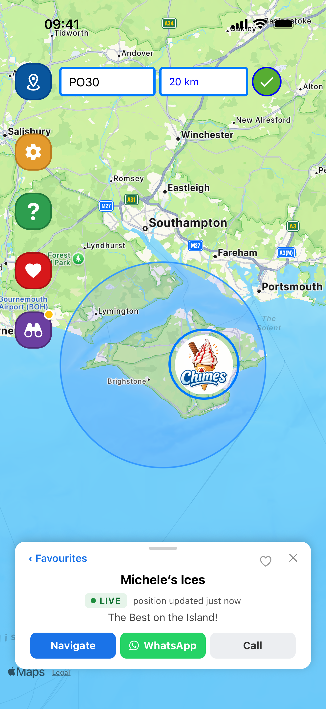

You know the feeling. You hear the chimes, you grab your purse, you get to the door, and the van
has gone. **Chimes** is a free app that makes sure that doesn't happen again.

## What Chimes does

Chimes puts ice cream vans and other mobile food vendors on a map, and tells you when one
arrives near you. There are already more than 1,600 vans and vendors on the map across England.

## For customers

- **Set your area.** Enter your postcode and choose how far you'd travel for an ice cream:
  anywhere from 500 metres to 20 km.
- **Get a chime.** When a van that's sharing its live location enters your area, your phone
  chimes, often before you'd hear the van.
- **See who's around.** Tap a van or vendor on the map to see who they are, what they sell
  and how to contact them.
- **Keep your favourites.** Save the vans you love so they're easy to find again.

There's no account to set up. Chimes is free on **iPhone** and **Android**.

## For vans and mobile vendors

If you run an ice cream van or a mobile food business, there are two ways to be on Chimes:

- **A free listing.** A pin on the map in your area, all year round, with your menu, WhatsApp
  and socials. There's no location tracking.
- **Live van tracking (free trial).** Share your location while you're working. Customers watch
  you move on the map, and get a chime on their phone as you arrive. You choose when sharing
  is on.

Registering takes a couple of minutes on an **iPhone or iPad**: open Chimes and go to
**Settings → Register your business**.

## Why a blog?

There's a lot going on: new features, stories from the vans on Chimes, and the odd bit of ice
cream van lore (did you know chimes are only allowed between noon and 7pm?). This is where
we'll share it.

## Get Chimes

- [Download on the App Store](https://apps.apple.com/gb/app/chimes/id6738628000)
- [Get it on Google Play](https://play.google.com/store/apps/details?id=com.justiot.chimes)
